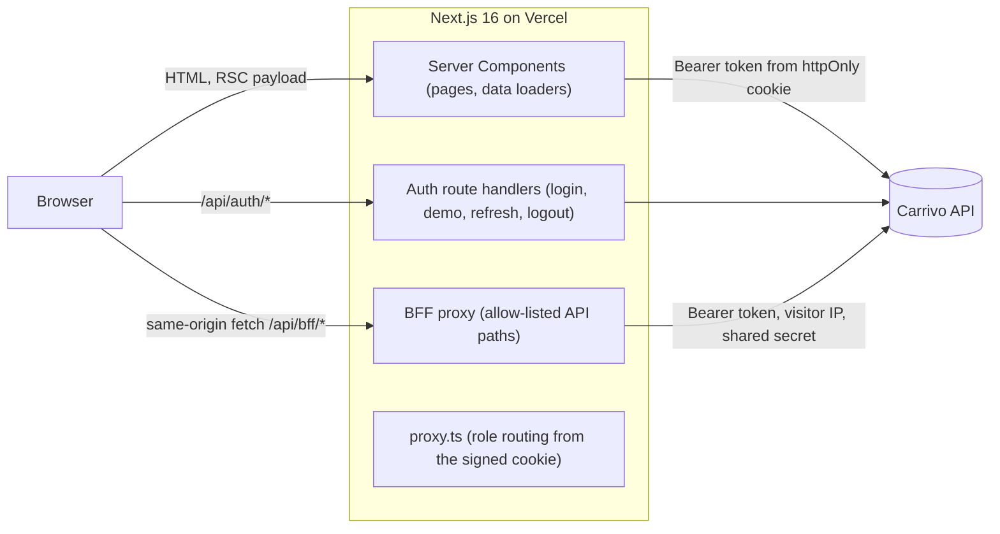

# Carrivo

Door-to-door parcel delivery with a price before you pay and tracking at every stop. This repository is the web app; it consumes the separate Carrivo API.


- **Live demo:** https://carrivo-frontend.vercel.app
- **Backend repository:** https://github.com/Zarif207/carrivo-backend

## Overview

Sending a parcel across town usually means a phone call, a price you learn at the door and no idea where the parcel is after pickup. Carrivo turns that into one flow: book online, see the price, pay by card, choose a pickup window and follow the parcel from the sender's door through the hubs to the receiver.

It serves three working roles and one observer:

| Role | Who | Home |
|---|---|---|
| Customer | People and small businesses sending parcels | `/dashboard` |
| Courier | Drivers who collect and deliver | `/courier` |
| Admin | Operations staff running zones, hubs, prices, assignments, payments and users | `/admin` |
| Admin Viewer | A read-only admin: sees everything an admin sees, changes nothing | `/admin` |

The platform is US-only: prices in USD, weights in pounds, US addresses and phone numbers, and business dates in one configurable time zone (America/New_York by default).

## Features

**Public site**
- Home page with live coverage (zones and hubs) and live example prices from the API
- Price calculator (`/pricing`) and parcel tracking by ID (`/track`), which shows stops and times but no personal details
- About, Services and Contact (the contact form prepares an email; there is no contact endpoint)
- Light and dark themes; smooth scrolling and scroll-driven motion on public pages only

**Customer**
- Overview with active, delivered and spend for today, this week, month or year
- Three-step booking with a live price (street, city, state and ZIP inputs; the draft survives a refresh)
- Card payment through Stripe Checkout, with success and cancel pages that verify with the API
- Pickup window scheduling (up to 12 hours, up to 30 days ahead)
- Shipment detail with the status timeline, courier, proof-of-delivery photo, and cancel with refund before pickup
- Payment history, notifications (bell and full list), profile and password

**Courier**
- Active tasks with search, status filter and sort; tap to call; open the address in Maps
- Only the next allowed status (picked up, delivered, failed with a reason, retry)
- Proof-of-delivery photo from camera or file, checked and compressed on the device, with upload progress
- Earnings by day or month with payout status; availability on or off; notifications

**Admin**
- Operations overview: revenue, shipments per day, shipments and payments by status, items needing attention, recent activity
- Shipments: filters, assign, reassign and unassign a courier, hub steps, return, cancel
- Users: search and filters, a side sheet with courier details, activate and deactivate
- Payments: totals, status filters and refund retry
- Reports: audit log with filters and CSV export of the rows on screen
- Settings: zones, hubs and pricing rules (create, edit, deactivate, delete as the API allows)

**Admin Viewer**
- Every admin page, filter, search, sort, chart, side sheet and CSV export
- A "View-only access" banner; no create, edit, delete, assign, status, refund or activation controls
- Writes are refused in the UI, in the BFF and by the API

## Architecture



Server Components render pages and call the API directly with the token from the cookie. Client components never see the token: they call the same-origin BFF, which attaches it. Login, logout, demo login and token refresh go through dedicated route handlers that set or clear the cookies.

**Key decisions**

- **Thin BFF instead of tokens in the browser.** The API issues bearer tokens. Keeping them in an httpOnly cookie and forwarding through `/api/bff/*` (an allow-list of the endpoints the UI uses) keeps tokens out of JavaScript and avoids CORS.
- **Two cookies.** The session cookie holds the token; a second cookie holds the role, signed with an HMAC over the role, expiry and a digest of the token, so it can't be edited or moved to another session.
- **Proactive, single-flight refresh.** The API only rotates a still-valid token, so the BFF rotates it when less than a day remains, once even when many requests arrive together. A 401 triggers one shared refresh attempt and one retry; after that the session ends.
- **Role-based proxy.** `proxy.ts` routes by the signed role cookie without calling the API. Area layouts then re-verify the user against the API, and admin data loaders check the role again.
- **Cache Components rules.** Cache Components is on. Public, rarely changing data (zones, hubs, example prices) is cached with `"use cache"`; anything that reads cookies, the request or the clock renders inside `<Suspense>`. The home page hero is in the static shell, so it paints without waiting for data or JavaScript.

More detail: [docs/ARCHITECTURE.md](docs/ARCHITECTURE.md). The API surface the UI depends on: [docs/API_CONTRACT.md](docs/API_CONTRACT.md).

## Tech stack

| Area | Choice | Why |
|---|---|---|
| Framework | Next.js 16 (App Router, Cache Components) | Server Components for data pages, route handlers for the BFF, partial prerendering |
| UI runtime | React 19 | Server Components, transitions and Suspense streaming |
| Language | TypeScript (strict) | Types for every API shape, checked on each build |
| Styling | Tailwind CSS 4 | Design tokens in one CSS file, light and dark themes |
| Components | shadcn/ui on Radix | Accessible primitives (dialogs, menus, tabs, accordion) styled locally |
| Server state | TanStack Query | Polling, cache invalidation and optimistic updates for notifications and quotes |
| Client state | Zustand | Small UI state and the booking draft (sessionStorage) |
| Forms | React Hook Form + Zod | One schema per form that mirrors the API's validation |
| Charts | Recharts | Composable charts; loaded lazily below the fold |
| Motion | GSAP + ScrollTrigger, Motion (Framer Motion), Lenis | Scroll-driven home page; all three load only on public pages, after first paint |
| Feedback | Sonner | Toasts for every mutation |
| Icons | Lucide | Consistent icon set |
| Images | `next/image`, browser-image-compression | Optimised remote images; photos shrunk on the device before upload |
| Dates | date-fns and `Intl` | Formatting in the business time zone so server and browser match |

## Route map

| Area | Routes | Access |
|---|---|---|
| Public | `/`, `/about`, `/services`, `/pricing`, `/contact`, `/track`, `/track/[trackingId]` | Everyone |
| Auth | `/login`, `/register` | Signed-out visitors (signed-in users go to their home) |
| Customer | `/dashboard`, `/dashboard/shipments`, `/dashboard/shipments/new`, `/dashboard/shipments/[id]`, `/dashboard/payments`, `/dashboard/notifications`, `/dashboard/profile` | Customer |
| Payment return | `/payment/success`, `/payment/cancel` | Customer |
| Courier | `/courier`, `/courier/tasks`, `/courier/tasks/[id]`, `/courier/earnings`, `/courier/notifications`, `/courier/profile` | Courier |
| Admin | `/admin`, `/admin/shipments`, `/admin/shipments/[id]`, `/admin/users`, `/admin/payments`, `/admin/reports`, `/admin/settings` | Admin, Admin Viewer (read-only) |
| Redirects | `/shipments/[id]` (email links) | Sends each role to its own view of the shipment |

## Demo access

The login page has three one-click demo buttons: **Customer**, **Courier** and **Admin (view-only)**. Each signs in to a seeded demo account on the server; the browser never receives the password. The admin demo is the read-only viewer, so the demo can't change data. The full admin account is not public and isn't reachable through the demo endpoint.

Payments run in Stripe test mode, so test cards from Stripe's documentation work.

## Getting started

**Prerequisites:** Node.js 20 or newer, npm, and a running Carrivo API (local or deployed).

```bash
npm install
cp .env.example .env.local   # then fill in the values
npm run dev                  # http://localhost:3000
```

**Environment variables** (names only; never commit values)

| Variable | Purpose | Required |
|---|---|---|
| `NEXT_PUBLIC_APP_URL` | This site's origin; used for metadata and the origin check on writes | Yes |
| `API_BASE_URL` | Base URL of the Carrivo API, including `/api/v1` (server only) | Yes |
| `SESSION_SECRET` | Signs the role cookie (server only, 32+ random characters) | Yes |
| `BFF_SHARED_SECRET` | Sent to the API with the visitor's IP for per-visitor rate limits; must match the API | Yes in production |
| `DEMO_PASSWORD` | Password of the seeded demo accounts (server only) | Only for demo login |
| `NEXT_PUBLIC_DEMO_CUSTOMER_EMAIL` | Customer demo account | Only for demo login |
| `NEXT_PUBLIC_DEMO_COURIER_EMAIL` | Courier demo account | Only for demo login |
| `NEXT_PUBLIC_DEMO_VIEWER_EMAIL` | Read-only admin demo account | Only for demo login |
| `NEXT_PUBLIC_CONTACT_EMAIL` | Address the contact form prepares a message for | Optional |
| `NEXT_PUBLIC_BUSINESS_TIME_ZONE` | Business time zone (defaults to America/New_York; must match the API) | Optional |

**Scripts**

| Command | What it does |
|---|---|
| `npm run dev` | Development server |
| `npm run build` | Production build |
| `npm start` | Serve the production build |
| `npm run lint` | ESLint (Next.js and React Compiler rules) |
| `npm run typecheck` | Generate route types, then `tsc --noEmit` |
| `npm test` | Unit tests with `node --test` |

## Project structure

```
src/
  app/          Routes: public site, auth, customer, courier, admin, payment return pages, BFF and auth route handlers
  components/   UI by feature (admin, courier, shipments, home, ...) plus shared building blocks and shadcn/ui
  config/       Navigation, site facts and other constants
  content/      Sample data for illustrative previews
  hooks/        Client hooks (auth, URL state, scroll behaviour)
  lib/          API client and server fetch, auth and permissions, data loaders, validation, formatting, time zone
  stores/       Zustand stores
  types/        API types and enums
  proxy.ts      Role-based routing
docs/           Architecture notes, the API contract, and a copy of the backend's docs
public/         Static assets and app icons
tests/          Unit tests (node --test)
```

## Security

- **Tokens stay on the server.** The API token lives in an httpOnly cookie and is attached by the BFF or by Server Components; client JavaScript never sees it.
- **Cookie flags.** Session cookies are httpOnly, SameSite=Lax, and Secure in production.
- **Signed role cookie.** The role used for routing is HMAC-signed and bound to the session, so editing it invalidates the session.
- **Server-side checks.** Layouts and admin data loaders re-verify the user with the API; the API enforces roles and ownership on every write. Mutating route handlers check the request's Origin.
- **Read-only viewer, three layers.** Write controls are hidden for the Admin Viewer, the BFF refuses its writes, and the API refuses them as well.
- **Narrow proxy.** The BFF forwards only an allow-list of method and path pairs.
- **Per-visitor rate limiting.** The API rate-limits by visitor; the BFF forwards the visitor's IP together with a shared secret so limits don't collapse onto the frontend server.
- **Headers.** Protected pages are sent with `Cache-Control: no-store`; the API sets its own security headers.
- **No secrets in the bundle.** Secrets are server-only environment variables; the demo password never reaches the client.
- **Validation on both sides.** Zod schemas in the forms mirror the API's validation, and the API validates every request again.

**Reporting a vulnerability.** Please report security issues privately through GitHub's private vulnerability reporting on this repository rather than in a public issue. Include steps to reproduce, and avoid accessing other people's data while testing.

## Performance and accessibility

Measured with Lighthouse 12 (mobile, simulated throttling) on a local production build of the home page, five runs:

| Performance | Accessibility | Best practices | SEO | CLS | TBT |
|---|---|---|---|---|---|
| 89 to 91 (median 91) | 100 | 100 | 100 | 0 | 20 to 40 ms |

These are local measurements, not the deployed site.

- The home page hero is in the static HTML; animation libraries load after first paint (GSAP after the first interaction or once the page is idle), and none of them ship to the dashboards.
- `prefers-reduced-motion` turns off smooth scrolling, pinning, scroll reveals and decorative animation; content is never hidden behind an animation.
- Colour tokens meet WCAG AA contrast in light and dark themes.
- Dialogs, menus, tabs, the accordion and segmented controls are keyboard operable with visible focus; focus returns to the opener when a dialog closes. A skip link leads to the main content.

## Testing and quality

- `npm test` runs unit tests for the US phone, ZIP and address rules, the business time zone (including daylight-saving changes) and the admin permission rules.
- `npm run lint` and `npm run typecheck` must pass, and `npm run build` must succeed, before a change is done.
- Role flows (customer, courier, admin, admin viewer) were checked manually in dev and in a production build, including refused viewer writes and a tampered role cookie. These checks are not automated yet.

## Deployment

1. Import the repository into Vercel; the framework preset is Next.js and the build command is `npm run build`.
2. Set `NEXT_PUBLIC_APP_URL`, `API_BASE_URL`, `SESSION_SECRET` and `BFF_SHARED_SECRET` for Production. Add `DEMO_PASSWORD` and the three `NEXT_PUBLIC_DEMO_*_EMAIL` variables to enable demo login, and `NEXT_PUBLIC_CONTACT_EMAIL` and `NEXT_PUBLIC_BUSINESS_TIME_ZONE` if needed.
3. Deploy, then point the API at the new domain: its frontend URL, payment success URL (`/payment/success`) and cancel URL (`/payment/cancel`), and its allowed CORS origins.
4. Check each demo role, a test payment and a proof-of-delivery upload.

## Git workflow

Commits follow [Conventional Commits](https://www.conventionalcommits.org/): `feat:`, `fix:`, `refactor:`, `style:`, `docs:`, `chore:`, with an optional scope such as `feat(auth):`. Each commit covers one focused change.

## Roadmap

- Security headers and a Content Security Policy set by the frontend itself.
- Automated end-to-end tests for the four roles, run in CI against a seeded test API.
- An admin screen to create courier and admin accounts (the API supports it; the UI doesn't yet).
- Structured address fields in the API (today addresses travel as one validated line).
- Courier payout marking once the API exposes it.
- Lighthouse checks in CI with a performance budget.

## License and author

No license has been chosen yet; until a license file is added, all rights are reserved.

Author: Zarif Hasan
