<a id="top"></a>

<div align="center">


# Carrivo

**Door-to-door parcel delivery across the US, with a price before you pay, Stripe payments and tracking at every stop.**

[](https://carrivo-courier.vercel.app)


[](LICENSE)

[**Live site**](https://carrivo-courier.vercel.app) · [**Backend API**](https://carrivo-backend.vercel.app/api/v1) · [**API docs**](https://github.com/Zarif207/carrivo-backend#endpoints) · [**API contract**](docs/API_CONTRACT.md)

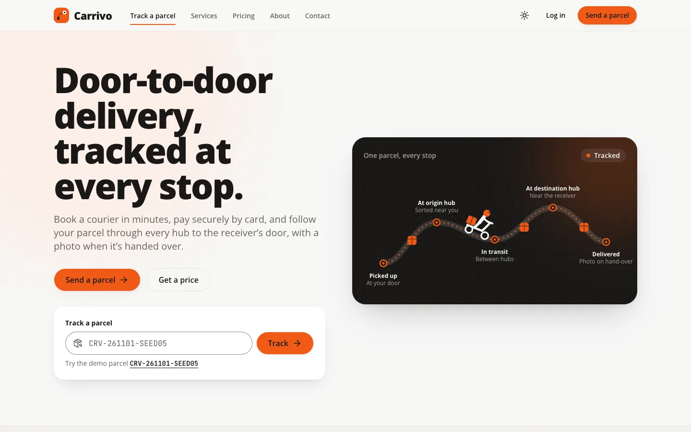

</div>


---

## Contents

1. [Overview](#overview)
2. [Screenshots](#screenshots)
3. [Features](#features)
4. [How it works](#how-it-works)
5. [Tech stack](#tech-stack)
6. [Engineering highlights](#engineering-highlights)
7. [Performance and quality](#performance-and-quality)
8. [Design system](#design-system)
9. [Project structure](#project-structure)
10. [Getting started](#getting-started)
11. [Demo access](#demo-access)
12. [API integration](#api-integration)
13. [Deployment](#deployment)
14. [Decisions, trade-offs and limitations](#decisions-trade-offs-and-limitations)
15. [Roadmap](#roadmap)
16. [Author](#author)
17. [License](#license)

---

## Overview

Sending a parcel across town usually means a phone call, a price you only learn at the door, and no idea where the parcel is after pickup. Carrivo turns that into one flow:

- **Customers** book online, see the price before paying, pay by card and choose a pickup window.
- **Couriers** collect and deliver from a phone-first task list and photograph the hand-over.
- **Operations staff** move parcels through the sorting hubs, assign couriers and run prices, payments and users.

The project is the frontend: a Next.js App Router app that consumes the separate [Carrivo API](https://github.com/Zarif207/carrivo-backend) through a thin backend-for-frontend, so the browser never holds an API token.

**At a glance**

- **Three roles plus a read-only viewer:** customer, courier and admin each have their own dashboard; the Admin Viewer sees every admin page but can't change anything.
- **A real shipment lifecycle:** booked → pickup scheduled → courier assigned → picked up → origin hub → in transit → destination hub → out for delivery → delivered, with up to three delivery attempts before a return.
- **Stripe Checkout** for every shipment, confirmed by the backend before the success page says "paid".
- **Proof of delivery:** couriers take the photo with the phone camera; it's compressed on the device and shown to the sender.
- **Tracking for anyone** with a tracking ID, without names, phone numbers or addresses.
- **US-only:** US dollars, pounds, US addresses and phone numbers, dates in one business time zone (America/New_York by default).

<p align="right"><a href="#top">Back to top</a></p>

---

## Screenshots

| | | |
| :---: | :---: | :---: |
| <br/>Home (light) | <br/>Home (dark) | 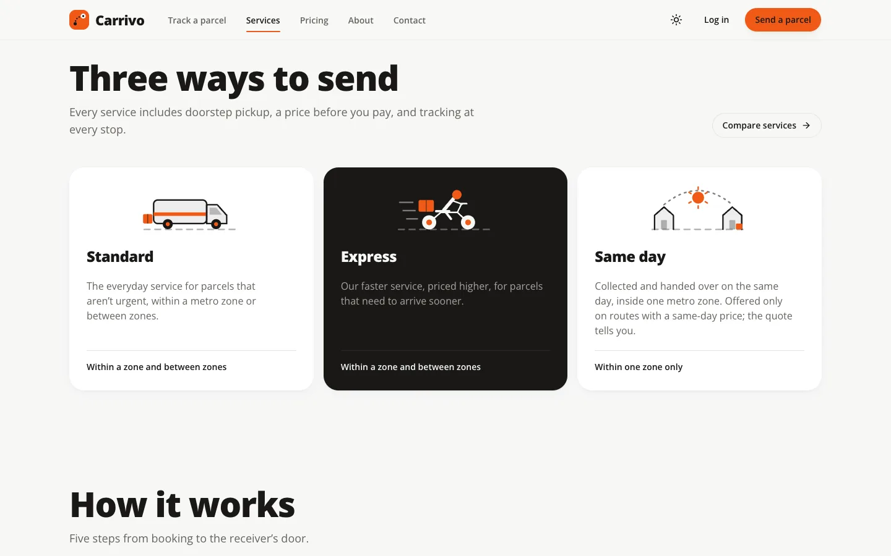<br/>Services |
| 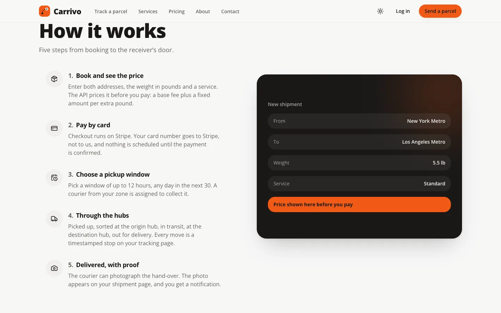<br/>How it works | 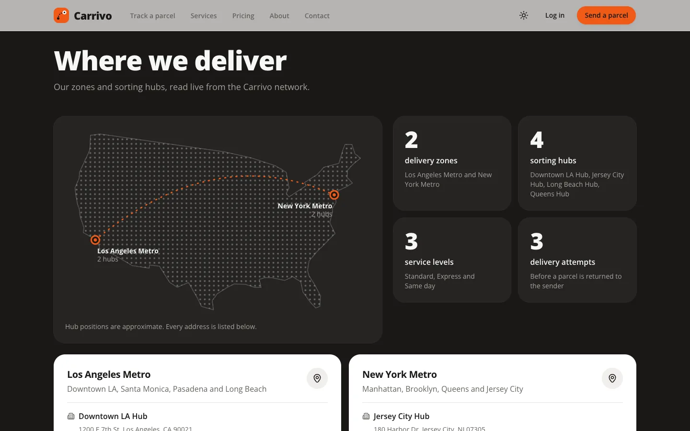<br/>Live coverage | <br/>Login + demo buttons |
| 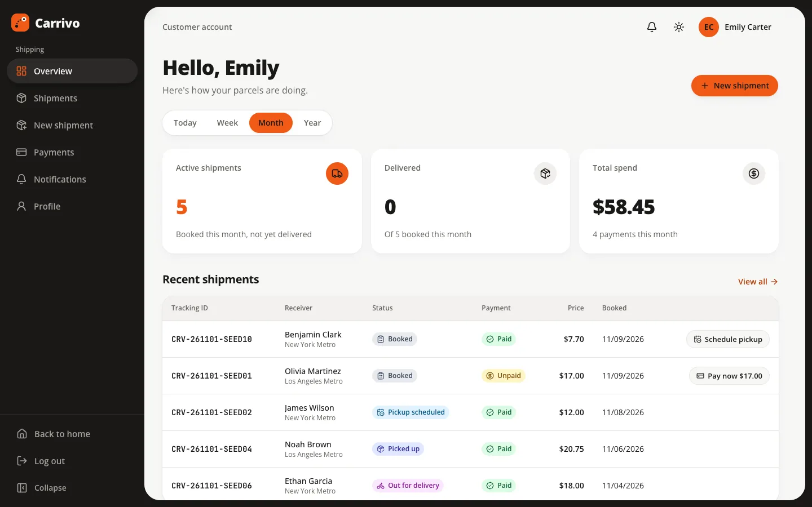<br/>Customer overview | 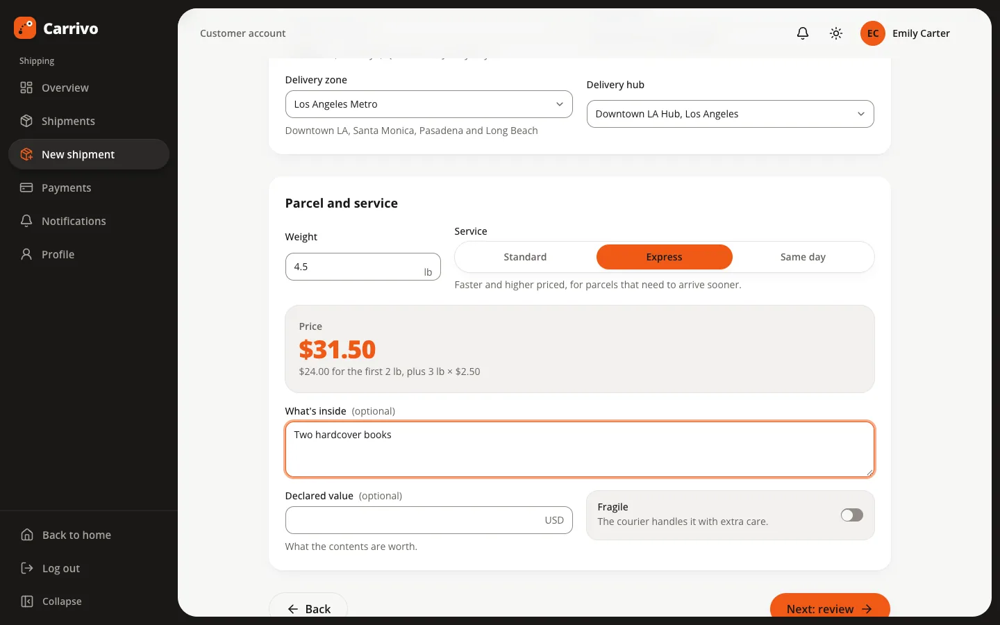<br/>New shipment (live price) | 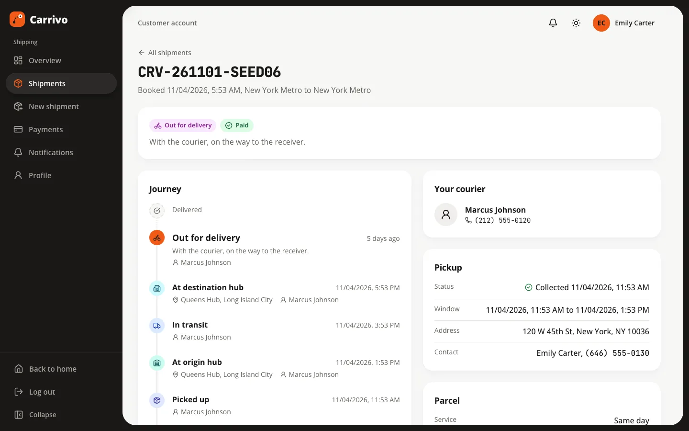<br/>Shipment detail + timeline |
| <br/>Payment success | 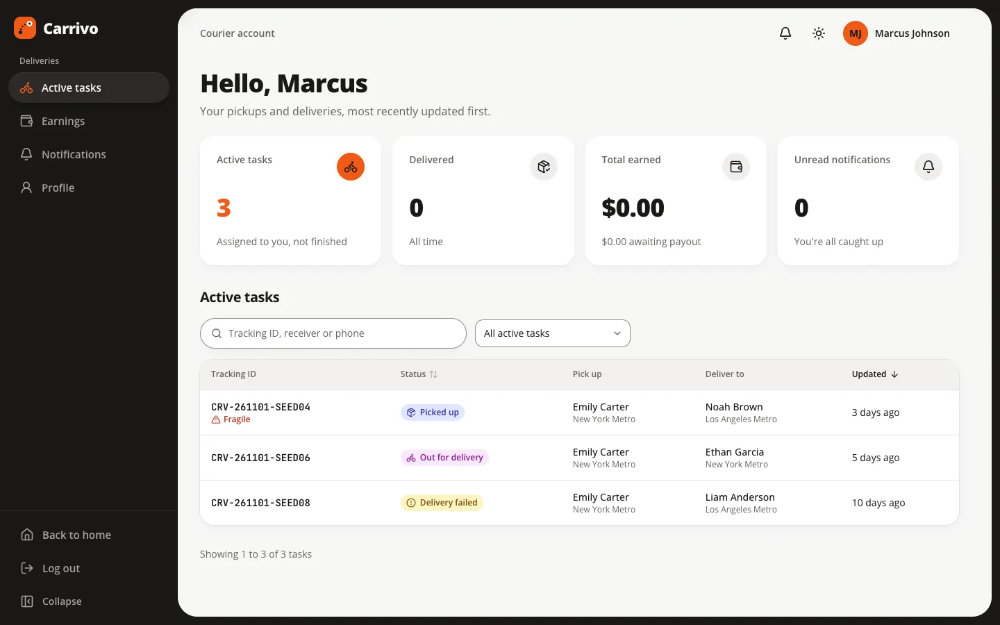<br/>Courier tasks | <br/>Courier notifications |
| 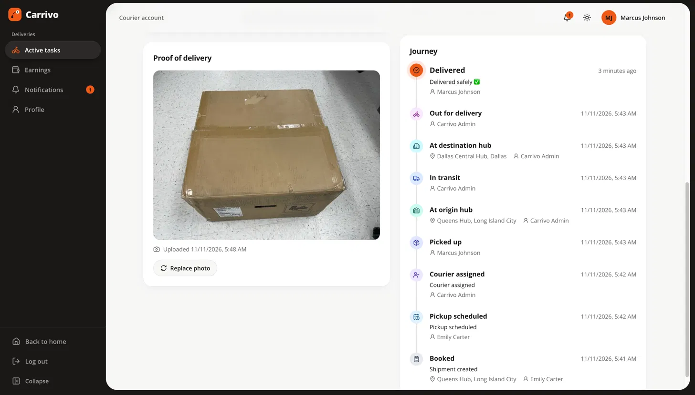<br/>Proof of delivery | <br/>Admin overview | 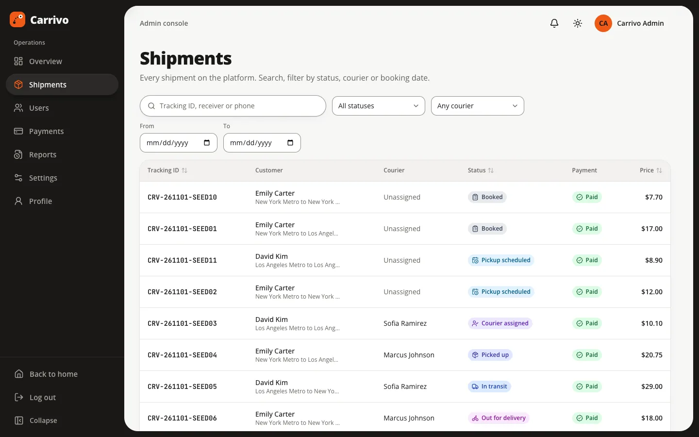<br/>Admin shipments |
| <br/>Admin users | <br/>Admin settings | 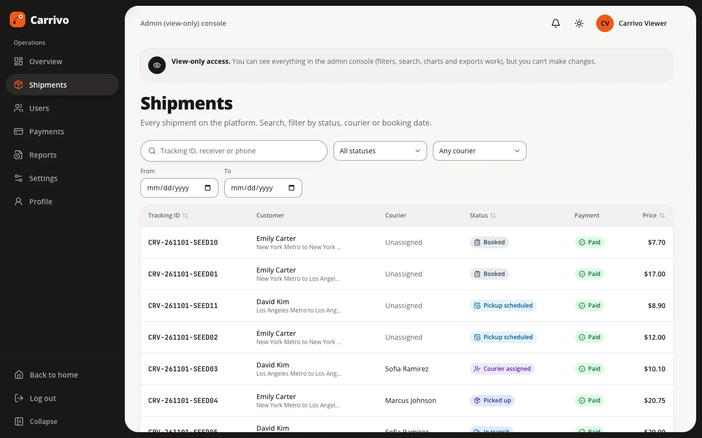<br/>Admin Viewer (read-only) |
| <br/>Admin profile | 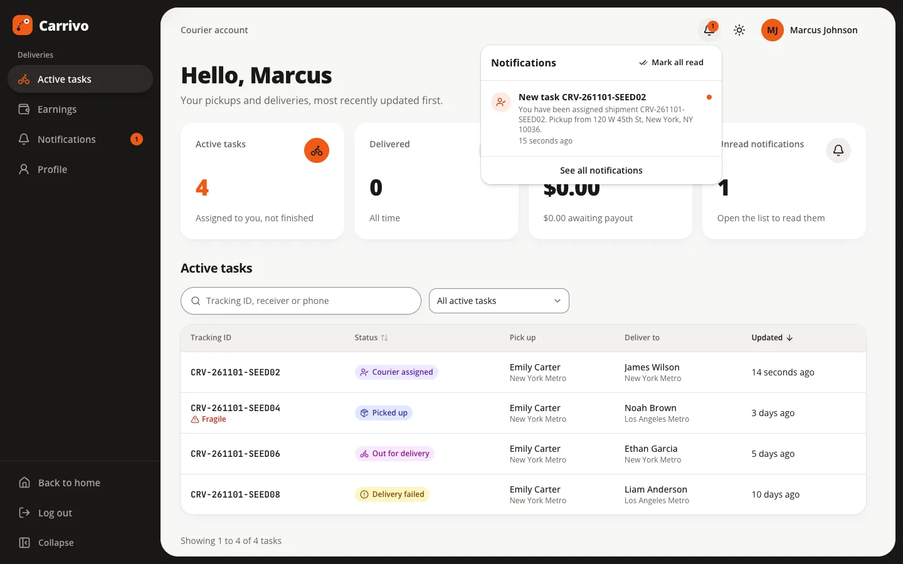<br/>Notifications | 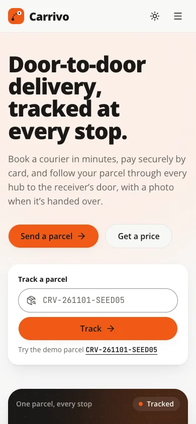<br/>Mobile home |
| 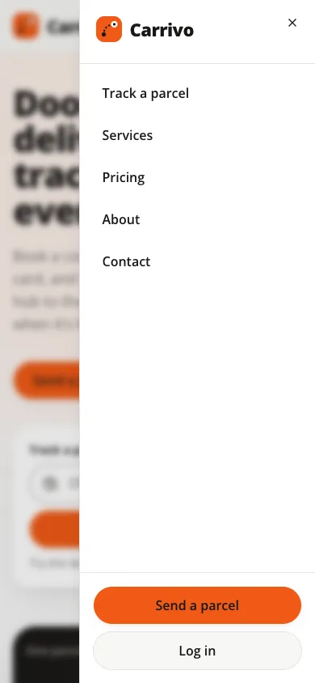<br/>Mobile menu | | |

Screenshots come from a local production build against a local API seeded with the US demo data. People, phone numbers (555-01xx) and addresses are fictional.

<p align="right"><a href="#top">Back to top</a></p>

---

## Features

### Customer

| Area | What they can do |
| --- | --- |
| Overview | Active shipments, deliveries and spend for today, this week, this month or this year; recent shipments with the next action (pay, schedule pickup) |
| Book | Three-step wizard: sender and receiver (street, city, state, ZIP), parcel and service with a live price, review and book; the draft survives a refresh and is cleared on logout |
| Pay | Stripe Checkout from the shipment, the list or the overview; success and cancel pages confirmed with the API |
| Pickup | Choose a window of up to 12 hours on any day in the next 30 |
| Track | Shipment detail with the full timeline, hubs, courier, pickup and parcel details, and the hand-over photo |
| Cancel | Before pickup, with an automatic refund when the shipment was paid |
| History and inbox | Payment history; notifications with a bell, unread count and full list |
| Profile | Name, US phone, default pickup address, photo link and password |

### Courier

| Area | What they can do |
| --- | --- |
| Active tasks | Pickups and deliveries that aren't finished, most recently updated first; search, status filter and sort |
| Task detail | Tap to call the sender or receiver, open the address in a maps app, and see only the next allowed step (picked up, delivered, failed with a reason, retry) |
| Proof of delivery | Photo from the camera or a file; JPEG, PNG or WebP, compressed on the device, uploaded with a progress bar |
| Earnings | By day or month, with payout status |
| Availability | One switch; unavailable couriers keep their tasks but get no new ones |
| Notifications and profile | New assignments and status changes; vehicle, number plate, zone and hub shown read-only |

### Admin

| Area | What they can do |
| --- | --- |
| Overview | Net revenue, shipments, active couriers, failed delivery rate; shipments booked per day (7, 14 or 30 days); shipments and payments by status; needs attention; recent activity; top couriers |
| Shipments | Search and filter by status, courier and date; assign, reassign and unassign couriers (only active, available couriers in the origin zone are offered); hub steps; return to sender; cancel |
| Users | Search, role and status filters; a side sheet with courier details; activate and deactivate |
| Payments | Totals and status filters; refunds and refund retry |
| Reports | Audit log with filters and a CSV export of the rows on screen |
| Settings | Zones, hubs and pricing rules: create, edit, deactivate and delete as the API allows |
| Profile | Name, phone, photo link and password |

### Admin Viewer (read-only)

| Area | What they can do |
| --- | --- |
| Viewing | Every admin page, filter, search, sort, chart, side sheet and CSV export |
| Changes | None: write controls are not rendered, a "View-only access" banner shows on every page, the BFF answers 403 before the API is called, and the API refuses the write too |
| Profile | Read-only details with a view-only note; no edit or password form |

### Public and SEO

| Area | What it does |
| --- | --- |
| Home | Static hero that paints before JavaScript, original illustrations, how it works, a tracking phone mockup built from the real timeline, live coverage map and facts, live example prices, promises and limits, role tour, FAQ |
| Tracking | `/track` and `/track/[trackingId]`: stops and times only, no personal details |
| Pricing | `/pricing`: a live quote calculator backed by the API's estimate endpoint |
| Pages | Services, About and Contact (the contact form prepares an email and says so) |
| Account menu | Signed-in visitors get an avatar menu with Dashboard, Profile and Log out in the public header |
| SEO | `metadata` with Open Graph on every public page, `sitemap.ts`, `robots.ts` (dashboards, API, tracking results and payment pages disallowed), `manifest.ts`, a generated Open Graph image; dashboards are `noindex` |
| Extras | Light and dark themes, smooth scrolling on public pages, a skip link |

<p align="right"><a href="#top">Back to top</a></p>

---

## How it works

### System architecture

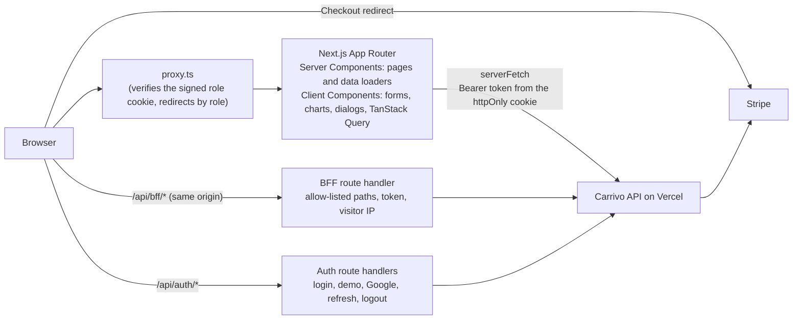

### Shipment lifecycle

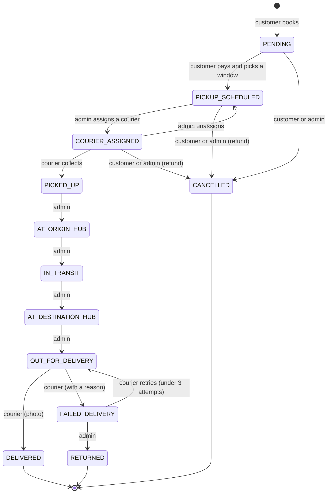

The labels the UI shows for these are Booked, Pickup scheduled, Courier assigned, Picked up, At origin hub, In transit, At destination hub, Out for delivery, Delivered, Delivery failed, Returned and Cancelled. The transitions live in `src/types/enums.ts` as a UI hint; the API is the authority.

### Payment flow

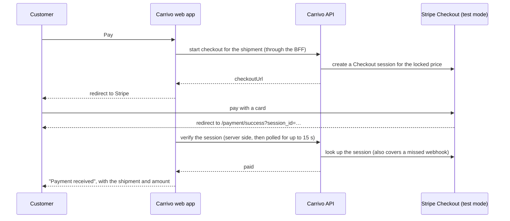

The redirect alone proves nothing; only the API's verification marks the page paid. `/payment/cancel` explains that nothing was charged.

### Proof of delivery

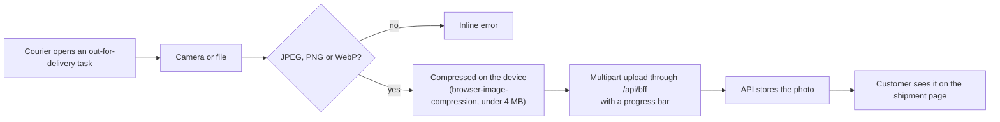

### Auth and route protection

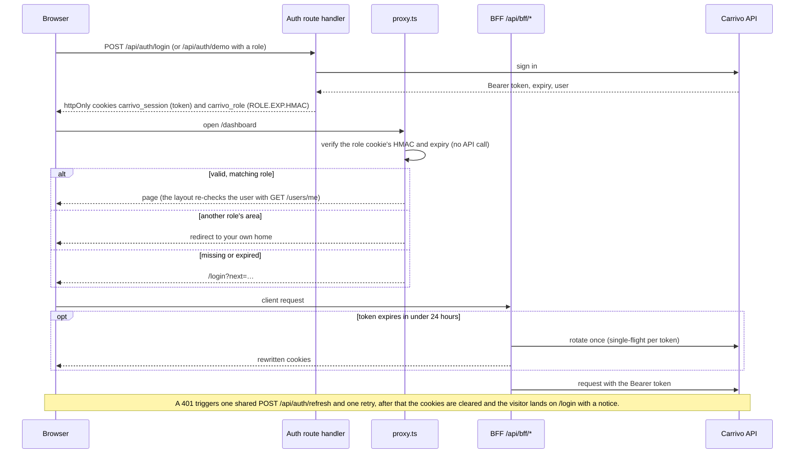

- **BFF:** client components never see the token; they call the same origin, and the BFF attaches it, forwards the visitor's IP with a shared header so the API rate-limits per visitor, and refuses every Admin Viewer write with 403.
- **Cookies:** both are httpOnly, SameSite=Lax and Secure in production. The role cookie is HMAC-signed over the role, the expiry and a hash of the token, so it can't be edited or moved to another session.
- **Defence in depth:** the proxy routes optimistically from the cookie, layouts re-verify with the API, and the API enforces roles and ownership on every request.

<p align="right"><a href="#top">Back to top</a></p>

---

## Tech stack

| Layer | Choice | Why |
| --- | --- | --- |
| Framework | Next.js 16 App Router, React 19, Cache Components, partial prefetching | A static shell with streamed request-time parts; Server Components for data pages; route handlers for the BFF |
| Language | TypeScript (strict) | Types for every API shape in `src/types`; no `any` |
| Styling | Tailwind CSS v4, shadcn/ui on Radix | Design tokens in CSS variables; accessible primitives |
| Server state | TanStack Query v5 | Polling, invalidation, optimistic updates with rollback |
| Client state | Zustand | The signed-in user for client components, sidebar state and the booking draft |
| Forms | React Hook Form + Zod | One schema per form that mirrors the API's validation; API field errors mapped onto fields |
| Charts | Recharts | Composable charts, loaded with `next/dynamic` |
| Motion | GSAP + ScrollTrigger, `motion`, Lenis | Scroll scenes on the public site only, loaded after first paint |
| Payments | Stripe Checkout (session created by the backend) | No card data touches this app |
| Images | `next/image`, browser-image-compression | Optimised remote images; proof photos shrunk before upload |
| Dates | date-fns and `Intl` | Formatting in the business time zone so server and browser agree |
| Feedback | Sonner | One toast system for every mutation |
| Testing | `node --test` | Unit tests for the US rules, the time zone and permissions |

<p align="right"><a href="#top">Back to top</a></p>

---

## Engineering highlights

- **A thin BFF instead of tokens in the browser.** `src/app/api/bff/[...path]/route.ts`, `src/lib/api/bff-allowlist.ts`
  - Only allow-listed method and path pairs are forwarded; bodies (including multipart uploads) and statuses stream through unchanged.
  - Read-only sessions are refused with 403 before the API is called.
- **Signed sessions.** `src/lib/auth/session.ts`, `src/lib/auth/refresh.ts`
  - `carrivo_role` is `ROLE.EXP.HMAC-SHA256(SESSION_SECRET, ROLE.EXP.sha256(token))`.
  - Tokens rotate when less than 24 hours remain, single-flight per token through an in-flight map, because the API revokes the old token on rotation.
- **One 401 policy.** `src/lib/api/client.ts`
  - Parallel 401s share one `/api/auth/refresh` attempt, the request is retried once, then the session ends with a toast and a redirect.
- **Route protection.** `src/proxy.ts`, `src/lib/auth/redirects.ts`, `src/lib/auth/current-user.ts`
  - The proxy never calls the API and marks protected responses `no-store`; `requireRole()` in each area layout re-checks the user against `GET /users/me`.
- **One permission module.** `src/lib/auth/permissions.ts`, `src/components/auth/role-gate.tsx`
  - `isStaff`, `isReadOnly` and `canMutate` are shared by the proxy, Server Components, the BFF and client components; admin write controls are wrapped in `<CanMutate>`.
- **Cache Components discipline.** `src/lib/data/public.ts`, `src/components/layout/public-header.tsx`
  - Zones, hubs and example quotes use `"use cache"` with `cacheLife("hours")` and tags; failed reads throw, so errors are never cached.
  - Everything that reads cookies, params or the clock renders under `<Suspense>`; the public header's account menu streams in so the shell stays static.
- **Typed API layer.** `src/lib/api/server.ts`, `src/lib/api/errors.ts`, `src/lib/api/endpoints.ts`
  - `serverFetch` adds the token, the visitor's IP and a 15 second timeout; one `ApiError` class carries status, message and field errors everywhere.
- **URL-driven lists.** `src/hooks/use-url-state.ts`, `src/components/shared/data-table.tsx`
  - Filters, search, sort and pagination live in the URL, so every list is bookmarkable and Back and Forward work.
- **Optimistic updates with rollback.** `src/components/admin/shipment-actions.tsx`, `src/lib/queries/notifications.ts`
  - Status steps, assignments, availability and mark-as-read update first and roll back on error.
- **US rules in one place.** `src/lib/us.ts`, `src/lib/validation/us.ts`, `src/lib/timezone.ts`
  - Phone, ZIP and address rules shared by every form; dates in the business time zone with daylight-saving handled.
- **On-device photo compression.** `src/components/courier/proof-uploader.tsx`, `src/lib/courier/upload-proof.ts`
  - Type and size checks, compression, and an XHR upload with progress.
- **Original illustrations.** `src/components/home/illustrations/`, `src/lib/geo/us-map.ts`
  - Inline SVG in theme tokens; the coverage map places the API's hubs from their addresses with a small conic projection.
- **Motion that never blocks.** `src/components/home/home-motion.tsx`, `src/components/home/gsap-scenes.tsx`
  - GSAP loads after the first interaction or when the browser is idle, pauses off screen, and is skipped under reduced motion.
- **Email links that land correctly.** `src/app/shipments/[id]/route.ts`
  - Sends customers, couriers and admins to their own view of a shipment, or to login with a return path.

<p align="right"><a href="#top">Back to top</a></p>

---

## Performance and quality

### Lighthouse

Recorded locally on 10 November 2026: mobile Lighthouse 12.8 (simulated throttling) against a local production build (`next start`) of the home page, five runs.

| Category | Target | Home |
| --- | --- | --- |
| Performance | ≥ 88 | 89 (median; 88 to 90, one run at 81 when the deferred animation bundle loaded during the measurement) |
| Accessibility | 100 | 100 |
| Best Practices | – | 100 |
| SEO | ≥ 90 | 100 |

Largest Contentful Paint 3.6 s (simulated slow 4G), Total Blocking Time 70 to 120 ms, Cumulative Layout Shift 0. These are local numbers, not the deployed site.

What keeps it there:

- The hero, including its illustration, is server-rendered HTML and SVG in the static shell.
- Animation libraries load after first paint and never on dashboards; hidden role-tab previews load on demand.
- Charts load with `next/dynamic`; every streamed section has a same-size skeleton.

### Tests (`node --test`, `tests/`)

| File | Covers |
| --- | --- |
| `us.test.mjs` | US phone, ZIP and address rules |
| `timezone.test.mjs` | Business time zone formatting, including daylight-saving changes |
| `permissions.test.mjs` | Admin permissions: only Admin may make changes, Admin Viewer is the only read-only role, and both count as staff |

16 unit tests in total. There are no automated end-to-end tests yet: role flows (sign-in, every route on direct load and refresh, refused Admin Viewer writes including direct BFF calls, a tampered role cookie, light and dark, 375/768/1280 widths, reduced motion) are checked by hand in development and in a production build. `npm run lint`, `npm run typecheck` and `npm run build` must pass before a change is done.

<p align="right"><a href="#top">Back to top</a></p>

---

## Design system

Orange on black and white: one confident accent, near-black ink, off-white pages and very soft shadows.

| Token | Light | Dark | Use |
| --- | --- | --- | --- |
| brand | `#F05A16` | `#F05A16` | Primary actions, active states, key numbers, chart lines, unread badges (never a status colour) |
| brand-foreground (ink) | `#191817` | `#191817` | Text on orange (5.2:1; white would be 3.4:1) |
| brand-text | `#B8400B` | `#FF8A52` | Orange text that meets AA contrast |
| background | `#F7F7F6` | `#121110` | Page |
| card | `#FFFFFF` | `#1C1B19` | Cards, panels |
| foreground | `#191817` | `#F7F7F6` | Text |
| muted text | `#66625D` | `#A6A29C` | Secondary text |
| sidebar | `#191817` | `#191817` | Dashboard sidebar in both themes |

- **Type:**
  - **Open Sans** (variable, 400 to 800) everywhere, with tighter tracking on headings and tabular figures for numbers.
  - **JetBrains Mono** only for tracking IDs and phone numbers.
- **Status:** one tone per shipment and payment status (green, blues, amber, red and neutral hues), always icon plus words.
- **Shapes:**
  - Pill buttons, segmented controls and search fields; 12 pixel inputs.
  - Cards with 20 pixel corners and a very soft shadow; the dashboard content sits in an inset 28 pixel panel beside a near-black sidebar.
- **Dark mode:** a theme of its own (`next-themes`, light, dark or device), with tokens defined once in `src/app/globals.css`.
- **Motion:** CSS for the hero, GSAP and Lenis for public scroll scenes; `prefers-reduced-motion` turns off smooth scrolling, pinning, reveals and decorative animation.
- **Dashboards:** on phones, a bottom tab bar with a "More" sheet; filters and lists stay in the URL.
- **Accessibility:** keyboard-friendly dialogs, menus, tabs and segmented controls with visible focus; focus returns to the opener; a skip link; status never by colour alone.

<p align="right"><a href="#top">Back to top</a></p>

---

## Project structure

```text
src/
├── app/                 # Routes: (public), (auth), dashboard, courier, admin, payment, shipments redirect, SEO files
│   ├── api/auth/        # Login, register, demo, Google start, refresh, logout, change password, session expiry
│   ├── api/bff/         # Same-origin proxy to the API for client components
│   └── auth/google/     # Google sign-in callback
├── components/
│   ├── ui/              # shadcn/ui primitives, restyled
│   ├── shared/          # DataTable, StatCard, StatusBadge, SearchInput, EmptyState, PageHeader, ConfirmDialog, timeline
│   ├── home/, public/   # Home sections, illustrations and motion; public building blocks and live data
│   ├── shipments/, payments/, notifications/, profile/   # Customer-facing features
│   ├── courier/, admin/, charts/                         # Role views and chart wrappers
│   ├── layout/, auth/, motion/, providers/               # Shells, menus, auth forms, smooth scroll, app providers
├── config/              # Navigation per role, site facts
├── content/             # Sample data for the illustrative previews
├── hooks/               # useAuth, useUrlState, useDebounce, usePagination, scroll behaviour
├── lib/
│   ├── api/             # serverFetch, the client fetch, endpoints, errors, BFF allow-list
│   ├── auth/            # Session cookies, refresh, permissions, redirects, current user
│   ├── data/            # Server data loaders, including cached public reads
│   ├── queries/         # TanStack Query hooks
│   ├── validation/      # Zod schemas and the US rules
│   └── …                # Formatting, status metadata, time zone, US data, map geometry
├── stores/              # Zustand stores
├── types/               # API types and enums, including the shipment state machine
└── proxy.ts             # Route protection (Next 16 middleware)
docs/                    # Architecture notes, API contract, backend docs copy, screenshots
tests/                   # Unit tests (node --test)
```

<p align="right"><a href="#top">Back to top</a></p>

---

## Getting started

**Prerequisites:** Node.js 20.9+, npm, and a running [Carrivo backend](https://github.com/Zarif207/carrivo-backend) (local or deployed).

```bash
git clone https://github.com/Zarif207/Carrivo.git
cd Carrivo
npm install
cp .env.example .env.local    # then fill in the values
npm run dev                   # http://localhost:3000
```

### Environment variables (`.env.local`)

| Variable | Scope | Description | Example shape |
| --- | --- | --- | --- |
| `NEXT_PUBLIC_APP_URL` | Browser and server | This site's origin, no trailing slash; used for metadata and the Origin check on writes | `http://localhost:3000` |
| `API_BASE_URL` | Server only | Carrivo API base URL including `/api/v1` | `http://localhost:5000/api/v1` |
| `SESSION_SECRET` | Server only | Signs the role cookie | 32+ random characters (`openssl rand -base64 48`) |
| `BFF_SHARED_SECRET` | Server only | Sent with the visitor's IP so the API rate-limits per visitor; must equal the backend's value | 32+ random characters |
| `DEMO_PASSWORD` | Server only | Password of the demo accounts, used only by the demo route handler | the demo password |
| `NEXT_PUBLIC_DEMO_CUSTOMER_EMAIL` | Browser | Account behind the Customer demo button | `customer1@carrivo.dev` |
| `NEXT_PUBLIC_DEMO_COURIER_EMAIL` | Browser | Account behind the Courier demo button | `courier1@carrivo.dev` |
| `NEXT_PUBLIC_DEMO_VIEWER_EMAIL` | Browser | Account behind the Admin (view-only) demo button | `viewer@carrivo.dev` |
| `NEXT_PUBLIC_CONTACT_EMAIL` | Browser | Optional; where the contact page prepares a message to | `support@your-domain.example` |
| `NEXT_PUBLIC_BUSINESS_TIME_ZONE` | Browser and server | Optional; must match the API | `America/New_York` |

### Scripts

| Command | What it does |
| --- | --- |
| `npm run dev` | Development server |
| `npm run build` / `npm start` | Production build / serve it |
| `npm run lint` | ESLint |
| `npm run typecheck` | Generate route types, then `tsc --noEmit` |
| `npm test` | Unit tests with `node --test` |

<p align="right"><a href="#top">Back to top</a></p>

---

## Demo access

The login page has a one-click button for each of these public demo accounts.

| Role | Email | Password |
| --- | --- | --- |
| Customer | `customer1@carrivo.dev` | `Carrivo#Demo2026!x7` |
| Courier | `courier1@carrivo.dev` | `Carrivo#Demo2026!x7` |
| Admin Viewer (read-only) | `viewer@carrivo.dev` | `Carrivo#Demo2026!x7` |

The admin account is private. Use the Admin Viewer to explore every admin page read-only.

**Stripe test card:** `4242 4242 4242 4242`, any future expiry date, any CVC. Stripe runs in test mode.

### Try it

1. Open [the live site](https://carrivo-courier.vercel.app), try the price calculator on **Pricing**, and track the demo parcel from the hero.
2. Log in with the **Customer** button and open **New shipment**; fill in both addresses, pick a service and watch the price update.
3. Book it, click **Pay**, and pay with the Stripe test card; you land on **Payment received**. Then schedule a pickup window.
4. Open a shipment that's on its way to see the timeline, the courier and, for delivered parcels, the hand-over photo.
5. Log out, log in with the **Courier** button, open a task, and see the next allowed status step and the proof-of-delivery uploader.
6. Log out, log in with the **Admin (view-only)** button, and open **Overview**, **Shipments**, **Users** and **Settings**. Every page shows the "View-only access" banner and has no write controls; a write sent directly is refused with 403.

<p align="right"><a href="#top">Back to top</a></p>

---

## API integration

- **The client:** Server Components call the API with `serverFetch`; client components call the same-origin BFF with `apiFetch`. Both return one typed envelope (`{ success, message, data, meta }`) and throw one `ApiError`.
- **What [docs/API_CONTRACT.md](docs/API_CONTRACT.md) covers:**
  - Every endpoint the UI uses: method, path, role, body and response.
  - The 401 and 403 handling, the refresh rules, the payment flow, the read-only viewer and the open questions.
- **Architecture notes:** [docs/ARCHITECTURE.md](docs/ARCHITECTURE.md).
- **The backend:** [carrivo-backend](https://github.com/Zarif207/carrivo-backend), whose README documents every [endpoint](https://github.com/Zarif207/carrivo-backend#endpoints) and the shipment state machine; a copy of its README and Postman collection lives in `docs/backend/`.

<p align="right"><a href="#top">Back to top</a></p>

---

## Deployment

The live site runs on **Vercel** (Next.js preset, default build settings). The backend is a separate Vercel project at `https://carrivo-backend.vercel.app/api/v1`.

1. Import [the repository](https://github.com/Zarif207/Carrivo) in Vercel. No build settings need changing.
2. Add these environment variables for Production (names and example shapes only):

   | Variable | Example shape |
   | --- | --- |
   | `NEXT_PUBLIC_APP_URL` | `https://carrivo-courier.vercel.app` |
   | `API_BASE_URL` | `https://carrivo-backend.vercel.app/api/v1` |
   | `SESSION_SECRET` | 32+ random characters (server only) |
   | `BFF_SHARED_SECRET` | the same value as the backend's (server only) |
   | `DEMO_PASSWORD` | the demo accounts' password (server only) |
   | `NEXT_PUBLIC_DEMO_CUSTOMER_EMAIL` | `customer1@carrivo.dev` |
   | `NEXT_PUBLIC_DEMO_COURIER_EMAIL` | `courier1@carrivo.dev` |
   | `NEXT_PUBLIC_DEMO_VIEWER_EMAIL` | `viewer@carrivo.dev` |
   | `NEXT_PUBLIC_BUSINESS_TIME_ZONE` | optional, e.g. `America/New_York` |

3. On the **backend** project, set:
   - `FRONTEND_URL` to `https://carrivo-courier.vercel.app`.
   - `CORS_ORIGINS` to a list that includes `https://carrivo-courier.vercel.app`.
   - `FRONTEND_SUCCESS_URL` to `https://carrivo-courier.vercel.app/payment/success`.
   - `FRONTEND_CANCEL_URL` to `https://carrivo-courier.vercel.app/payment/cancel`.
   - `BFF_SHARED_SECRET` to the same value as the frontend's.

   Then redeploy the backend.
4. Deploy, then smoke-test the live URL: the home page and `/pricing` load live data; each demo button signs in and lands on its home; a test payment reaches **Payment received**; a courier can pick a proof photo; the Admin Viewer sees the banner and a direct write is refused.

<p align="right"><a href="#top">Back to top</a></p>

---

## Decisions, trade-offs and limitations

### Decisions and trade-offs

- **BFF with httpOnly cookies:** the API issues bearer tokens. Keeping them in cookies and proxying through `/api/bff/*` keeps them out of JavaScript and avoids CORS, at the cost of one extra hop for client requests.
- **Proactive refresh:** the API only rotates a still-valid token and revokes the old one, so the BFF rotates before expiry, single-flight, instead of reacting to a 401.
- **Signed role cookie for routing:** the proxy can redirect by role without an API call; layouts still re-verify, so a stale cookie never shows another role's data.
- **Money arrives as strings:** prices are 2-decimal strings in US dollars and are formatted, not parsed into floats for display.
- **Contact form:** it opens a prepared email and says so; the API has no contact endpoint.
- **Courier home shows active tasks**, not "today's tasks": the API has no date filter for tasks.
- **Admin charts:** shipments per day, shipments by status and payments by status; the API has no revenue time series.

### Known limitations

- **Coverage map:** hubs have no coordinates in the API, so pins are placed from the address (city, else the state's centre) and are approximate; the hub list beside it is exact.
- **Without JavaScript:** the static parts of every page render, but live sections streamed under `<Suspense>` (coverage, prices) stay on their skeletons.
- **Addresses** travel to the API as one validated line; the UI splits and joins them.
- **Avatars:** a photo link only; there is no avatar upload.
- **Payouts:** couriers see payout status, but marking payouts paid isn't in the API yet.
- **Google sign-in** always creates a customer account.
- **Payments:** Stripe runs in test mode.
- **Locations:** the US only.

<p align="right"><a href="#top">Back to top</a></p>

---

## Roadmap

- Automated end-to-end tests for the four roles in CI against a seeded test API.
- Security headers and a Content Security Policy set by the frontend.
- An admin screen to create courier and admin accounts (the API supports it).
- Structured address fields in the API.
- Courier payout marking once the API exposes it.
- Record Lighthouse scores in CI and fail the build when they fall.

<p align="right"><a href="#top">Back to top</a></p>

---

## Author

**Zarif Hasan** · [github.com/Zarif207](https://github.com/Zarif207)

<p align="right"><a href="#top">Back to top</a></p>

---

## License

Released under the MIT License. See [LICENSE](LICENSE).

<p align="right"><a href="#top">Back to top</a></p>
